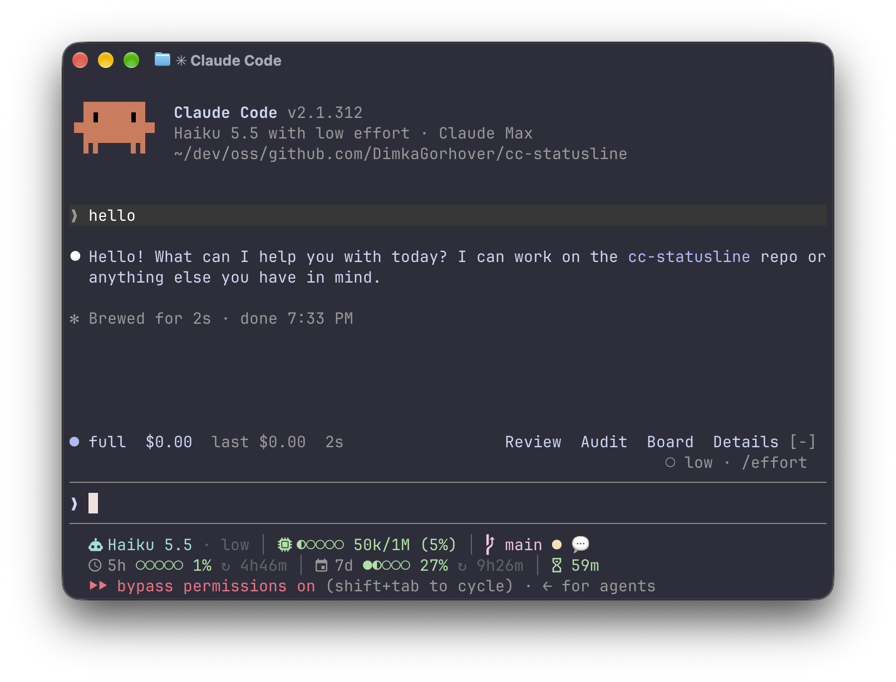

# cc-statusline

A two-line [Claude Code](https://code.claude.com/docs/en/statusline) status line in one Python file,
with no dependencies.



## What it shows

Line 1:

- **Model and effort**: `Haiku 5.5 · low`
- **Context**: how much of the context window is used, as a bar, token counts and a percentage
- **Lines changed** this session: `+12 -3`, shown only after the first edit
- **Branch or worktree**, from [`wt`](https://github.com/max-sixty/worktrunk):
  - `●` when there are uncommitted changes
  - `⇡`/`⇣` for commits ahead of or behind upstream
  - the worktree's marker, e.g. 🤖 while Claude works and 💬 while it waits
  - the markers of the repo's other worktrees, e.g. `2🤖 1💬`

Line 2:

- **5-hour and 7-day rate limits**: usage bar, percentage and time until reset
- **Prompt cache**: time until it goes cold

Each segment is hidden when Claude Code doesn't send its data. The colors go green, yellow and
red at 50% and 80%.

Subagents get their own row with name, model, effort and context.

## Requirements

- Python 3.9+ (macOS's `/usr/bin/python3` works)
- A [Nerd Font](https://www.nerdfonts.com/) in your terminal, for the icons
- Optional: [`wt`](https://github.com/max-sixty/worktrunk) for the branch/worktree segment.
  Without it, that segment is hidden. The `wt list` result is cached for 5 seconds in
  `$XDG_CACHE_HOME/cc-statusline` (`~/.cache/cc-statusline` by default).
- Optional: Worktrunk's Claude Code plugin, which sets the 🤖/💬 markers:
  `wt config plugins claude install`. You can also set a marker yourself with
  `wt config state marker set 🚧`.

## Install

```sh
git clone https://github.com/DimkaGorhover/cc-statusline.git ~/.local/share/cc-statusline
python3 ~/.local/share/cc-statusline/statusline.py setup
```

`setup` points `statusLine` and `subagentStatusLine` in `~/.claude/settings.json` (or
`$CLAUDE_CONFIG_DIR/settings.json`) at the cloned script. It saves a backup to `settings.json.bak`
first. If settings.json is a symlink, for example into a dotfiles repo, `setup` writes the file it
points to. Leave the clone where it is: settings.json runs the script from that path.

If another status line is already configured, `setup` refuses and changes nothing. Rerun it with
`-f` to replace that status line. A copy of this script at a different path counts as another
status line too, so after moving the clone, run `setup -f` from the new place.

## Upgrade

```sh
git -C ~/.local/share/cc-statusline pull
python3 ~/.local/share/cc-statusline/statusline.py setup
```

The pull brings in new code. Rerunning `setup` picks up any change to the settings.json entries,
and prints `already up to date` when there is none.

## Options

```sh
python3 statusline.py setup [--bar STYLE] [--refresh-interval N] [--settings PATH] [--dry-run] [-f]
```

| Option                 | Default                    | Description                                                                          |
| ---------------------- | -------------------------- | ------------------------------------------------------------------------------------ |
| `--bar STYLE`          | `circles`                  | Bar style: `circles` (Material Design), `circles-fa` (Font Awesome) or `line` (`▬`) |
| `--refresh-interval N` | `60`                       | `refreshInterval` for statusLine, in seconds; `0` leaves it unset                    |
| `--settings PATH`      | `~/.claude/settings.json`  | Settings file to write                                                               |
| `--dry-run`            |                            | Show the changes without writing                                                     |
| `-f`, `--force`        |                            | Replace a status line set by another tool                                            |

## Development

```sh
mise install          # prek, ruff, ty, uv, gitleaks
prek install          # git pre-commit hook
uv run pytest         # tests (the dev environment uses Python 3.13+)
mise run pre-commit   # all hooks on all files
```

pytest needs a newer Python than the 3.9 the script supports, so the `py39-smoke` hook also renders
`tests/input.json` on Python 3.9.

## License

[MIT](LICENSE)
